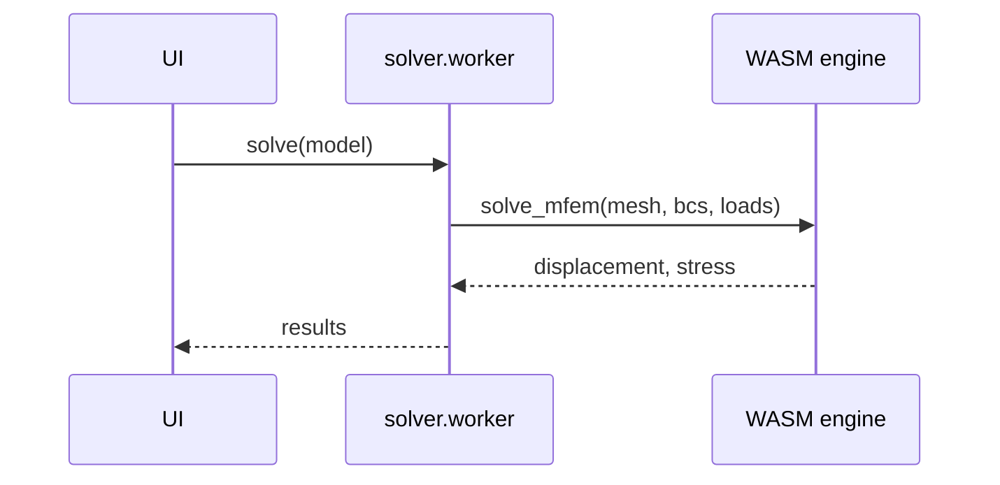

# PR

A reviewer should understand the change from the Summary visual, trust it from
the Evidence, and judge the risk from Merge Danger, before opening the diff.

## Workflow

1. **Branch** from `develop`; the PR targets `develop` (see `AGENTS.md`).
2. **Capture the red run first.** Before changing code, run the test or repro
   that shows the problem on the base and save the trimmed output. If no test
   can show it, write one. A fix without a failing-then-passing run is a claim,
   not evidence.
3. Make the change, then run the repo checks for the areas you touched
   (`AGENTS.md` → Build and checks). Re-run the step-2 test and save the green
   output.
4. For visual changes, take before/after screenshots with Playwright (the
   `run` skill, or `web/tests/*.spec.ts` patterns). Upload them to the Linear
   issue's evidence comment, editing one comment in place, and link that
   comment from the PR.
5. Write the body with the template below and open the PR against `develop`.
   Title: imperative, user-facing, no issue key. Do not touch `CHANGELOG.md`.

## Template

~~~markdown
## Summary

<one or two sentences: what changes for the user, and why>

<diagram, diff-sketch, or tree>

Fixes KOF-nn

## Evidence

**Before** (`develop` @ <short sha>): <failing test / wrong output / screenshot link>

```text
<command>
<trimmed output showing the failure>
```

**After** (this branch):

```text
<same command>
<trimmed output showing the pass>
```

<checks run: e.g. `bun run typecheck && bun run lint && bun run test` — pass>

## Key Changes

- **engine:** …
- **web:** …

## Merge Danger

**Door:** <one-way or two-way>

<optional: description>

**Blast Radius:** <one word>

<optional: what could break: solver paths, per-body materials, saved .kofem files, WASM exports, layout>

## Checklist

- [ ] **No silent fallbacks** — no code path substitutes a plausible default when data is missing, invalid, or mismatched, instead of raising a clear error.
- [ ] Every input accepted by the UI or an API is actually consumed downstream
- [ ] All applicable solver paths covered (solid / shell / coupled), or N/A
~~~

Keep `Fixes KOF-nn` only when the PR resolves that issue; otherwise write
`Refs KOF-nn`. Keep the Checklist from `.github/pull_request_template.md` in
sync with this template if either changes.

## Sections

Skip all preambles and keep prose brief. Use KoFEM's domain language from
`AGENTS.md`: tessellation is for display; surface and volume meshes are FEM
discretisations. Say "body", "face", "BC group", "load group", "solid",
"shell", "coupled".

### Summary

Pick the smallest view that makes the key point clear.

- Show logic or an algorithm as pseudocode:

```text
on(save)
  if content is unchanged
    return cached result
  write new content
  return fresh result
```

- Show runtime control flow as a call tree:

```text
solver.worker onmessage("solve")
  groupDirichlet
  solve_mfem
    collect_essential_dofs
      add_fixed_dofs
      add_prescribed_dofs
```

- Show UI structure as a component tree, including state and module boundaries that matter:

```text
<StatusBar> (web/src/components/statusbar/StatusBar.tsx)
  useModelStore(loads, surfaceLoads)
  <LoadStat>
```

- Show file responsibility or a broad refactor as a shallow file tree:

```text
web/src/components/viewport/
├── BoundaryConditionLayer.tsx   # composes the layers below
├── BcFaceHighlights.tsx         # selected / pending / BC / load faces
└── LoadArrows.tsx               # face and nodal load arrows
```

- Show component interaction, control flow, or data flow with Mermaid:



- Use `diff` when the point is what changes and the surrounding shape already exists. Match the diff shape to the topic. **This is the preferred view for most bug fixes**: show the few lines that carry the fix, not the whole patch.

For a code change, quote only the decisive lines:

```diff
 VDir& vd = vdir[vi];
+if (vd.set[c] && vd.value[c] != value)
+  throw std::runtime_error("vertex " + std::to_string(vi) + " has conflicting BCs");
 vd.set[c] = true;
 vd.value[c] = value;
```

For a component change:

```diff
 <SessionPage>
   useSessionEvents()
   <SessionToolbar>
+    <RunSkillButton />
   <SessionTimeline>
+    <SkillResultCard />
```

For a file-layout change:

```diff
 src/
 ├── commands/
+│   └── show-me.ts       # expands the slash command
 ├── sessions/
-└── transport.ts
+└── transport/
+    ├── client.ts
+    └── stream.ts
```

For a call-tree or call-stack change:

```diff
 submitForm
   createSession
     persistPrompt
+    expandSkillMention
     launchAgent
-  navigateToSession
+  navigateToSession
+    subscribeToEvents
```

For a state or control-flow change:

```diff
 on(save)
-  write content
+  if content is unchanged
+    return cached result
+  write new content
+  invalidate cache
```

- Show the whole block when most of it is new, when omitted context would hide ownership or order, or when the user needs a copyable target shape:

```ts
function loadsSummary(nodalLoadDofs: number, faceLoads: number): string {
  // ...
}
```

#### Guidance

Place each visual next to the short text it supports. Keep only the calls,
files, props, states, and boundaries needed to answer the reviewer's question.

You may use one of these, you may use several, it is unlikely you will use all
of them. Use your judgement and don't overwhelm the reviewer.

### Evidence

Concrete evidence that the change works. Always show a before and after, and
name the base commit the "before" ran on.

Screenshots are S-tier when the change is visual. Put them on the Linear
issue's evidence comment and link it.

Execution-based evidence is A-tier: test results, console output, solver logs.
Show the exact test that failed on `develop` and passes on the branch. Trim
output to the lines that prove the point; never paste a whole log.

For pure refactors, the evidence is that behaviour is unchanged: the same
specs pass before and after, plus a size or structure comparison
(`wc -l`, file tree).

For dead-code removal, show the search that proves nothing calls it, and the
green build and tests after removal.

Never claim a check passed that you did not run. If a check could not run in
your environment (e.g. no WASM build), say so in Evidence.

### Merge Danger

Describe whether it's a one-way or two-way door. You can walk back through
two-way doors, but not one-way doors. A PR that is cheap to roll back is lower
risk. In KoFEM, one-way doors include: changing the saved `.kofem` file format,
removing a WASM export that published builds or examples rely on, and changing
default analysis settings that alter existing results.

The blast radius is the potential impact or scope of the changes introduced by
this PR. Consider all possibilities: which solver paths (solid, shell,
coupled), per-body materials, saved models, gallery examples, layout and mobile
width, and analytics.
